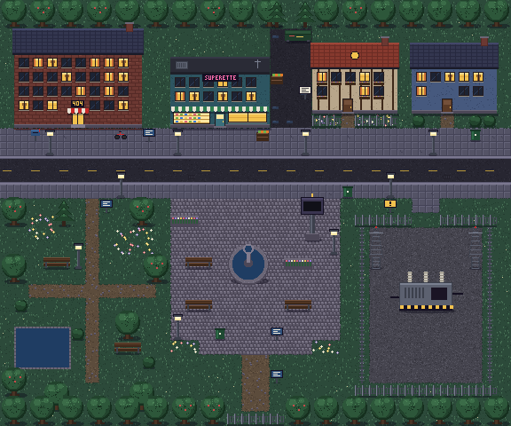

# Sparrowgotchi RPG — Chapitre 1 : La Ville Figée

Première démonstration jouable de l'aventure : on sort de l'appartement, on explore le **Quartier 404**, de nuit, on parle à quatre personnages et on termine la quête **« La Ville Figée »**.

## Analyse de l'existant et choix techniques

- **Base** : Next.js 16 + React 19. Le Sparrowgotchi tournait déjà sur un moteur canvas maison :
  - appartement de 5 pièces en 160 × 144 ;
  - croix, A/B, START/SELECT ;
  - sauvegarde `sp.gotchi.v1` ;
  - mini-jeux farm et muscu.

  Tout cela est conservé tel quel.
- **Phaser** : étudié puis **écarté pour cette étape**.
  - La version 4 ajouterait plus d'1 Mo de JavaScript à l'application. Elle devrait aussi entrer dans le cache hors ligne de l'appli, et passer par une intégration côté client spécifique à Next.js.
  - Nos besoins sont couverts par une couche RPG légère, sans dépendance :
    - carte en cases de 16 px ;
    - calques pré-rendus ;
    - tri de profondeur ;
    - collisions ;
    - caméra ;
    - éclairage.
  - Mesure sur iPhone simulé : environ 16,5 ms par image, soit un 60 i/s stable.
  - À réévaluer si l'on veut des cartes **Tiled** très nombreuses, de la physique ou un moteur de combat complexe. Les données de carte sont déjà séparées du rendu, ce qui faciliterait une migration.
- **Pixels nets** : le canvas fait 240 × 176 px (format proche de la GBA) et s'affiche avec `image-rendering: pixelated`, sans lissage. L'appartement (160 × 144) apparaît centré sur fond noir, comme les intérieurs des RPG portables.

## Fichiers

| Fichier | Rôle |
|---|---|
| `src/lib/rpg/quartier.ts` | Carte du Quartier 404 : sol, éléments posés (emprise au sol et partie haute), portes, zones, PNJ, collisions, accessibilité |
| `src/lib/rpg/state.ts` | État sauvegardé de l'aventure (`state.rpg`) |
| `src/lib/rpg/quest.ts` | Quêtes, objets d'aventure, effets (étapes, objets, drapeaux), récompenses |
| `src/lib/rpg/script.ts` | Scénario : dialogues conditionnels des PNJ, textes des objets, scène finale |
| `src/components/rpg/pixel.ts` | Cuisson de sprites, police bitmap 3 × 5, halos de lumière nets |
| `src/components/rpg/actors.ts` | Sprites des personnages (5 personnages × 3 directions × 3 images) |
| `src/components/rpg/tiles.ts` | Tileset et décors, peints une fois dans deux calques (bas et haut), éléments animés |
| `src/components/rpg/overworld.ts` | Moteur d'exploration : déplacement case par case, PNJ, caméra, nuit, particules, scène finale |
| `src/components/gotchi/Gotchi.tsx` | Console : passage appart ↔ rue, dialogues avec nom, notifications, menu, sauvegarde |

## Graphismes : gestion des assets et provenance

- **Provenance** : tous les graphismes sont **originaux** et créés pour ce projet, directement dans le code. Aucune ressource Pokémon, Nintendo ou tierce n'est utilisée.
- **Sprites des personnages** : grilles de texte (1 caractère = 1 pixel) recolorées par une palette propre à chaque personnage.
- **Tileset et décors** : fonctions de peinture pixel par pixel, avec une palette de nuit unique (`P` dans `tiles.ts`) partagée par le sol, les bâtiments, la végétation et les personnages.
- **Cuisson** : au démarrage, tout est cuit dans des canvas en cache. Ce sont nos « spritesheets » : un sprite par personnage, direction et image, et deux grands calques de carte.
- **Intégrer de vrais fichiers PNG plus tard** (par exemple dessinés sous Aseprite, ou sous licence compatible comme CC0) :
  1. Les placer dans `public/rpg/`.
  2. Les charger avec `new Image()` à la place de `bakeRows` (même découpe : 16 × 20 par image, 3 images par direction).
  3. Noter leur auteur et leur licence dans ce fichier.
- **Vue d'ensemble** : avec `?debug`, la fonction `window.__rpg.overview()` exporte la carte complète en PNG (c'est l'image ci-dessus).

## Contrôles

- **Croix** : 4 directions, case par case, avec animation de marche. **B** maintenu : courir.
- **A** : parler au PNJ en face, examiner un objet, frapper à une porte, ou faire avancer un dialogue. **B** : faire avancer un dialogue ou annuler.
- **Portes** : on entre en marchant vers le haut dans la porte de la Résidence Les Lilas. Dans l'appart, la porte d'entrée est en haut du salon.
  - Après une porte, il faut relâcher la croix pour en reprendre une : pas d'aller-retour involontaire.
- **PNJ** : ils s'arrêtent quand Sparrow est juste à côté d'eux.
- **Clavier** : flèches ou ZQSD, Entrée = A, Échap = B, M = START, Maj = courir.

## Quête « La Ville Figée »

1. Sortir de l'appartement.
2. Explorer jusqu'à la place de la Fontaine.
3. Discuter avec Nico le Livreur (il donne une pizza tiède).
4. Examiner la grande horloge (23:59).
5. Trouver le badge de maintenance dans la benne de la ruelle. Raymond et Madame Bouchon donnent l'indice.
6. Ouvrir le portail et entrer dans la station électrique.
7. Examiner le transformateur, ce qui déclenche la scène finale :
   - l'inconnu apparaît ;
   - Sparrow obtient le fragment d'horloge n°1 ;
   - les horloges passent à 00:00 ;
   - la barrière du Centre-ville se lève, pour le chapitre 2.

Les étapes peuvent se faire dans le désordre, et rien ne peut bloquer la progression. Les quêtes sont dans **MENU → Quêtes**, séparées des **missions du jour**.

## Sauvegarde

- **Aventure** : `state.rpg` (quêtes, étapes, objets, drapeaux, lieux découverts), dans la sauvegarde existante `sp.gotchi.v1`. Une ancienne sauvegarde reçoit simplement une aventure vide.
- **Position** : `sp.gotchi.where` (dehors ou dans l'appart) et `sp.gotchi.place` (position dans l'appart). À la réouverture, Sparrow reprend exactement là où il était, dedans ou dehors.

## Ajouter du contenu

- **Élément de décor** : une ligne dans `PROPS` (`quartier.ts`). Pour un nouveau type d'élément, ajouter aussi son dessin dans `tiles.ts`.
- **PNJ** :
  1. son sprite dans `actors.ts` ;
  2. sa position et son trajet dans `NPCS` ;
  3. ses répliques dans `NPC_TALK` (`script.ts`).
- **Quête** : une entrée dans `QUESTS`. Les étapes se cochent avec l'effet `{ kind: "step" }` attaché à un dialogue, un objet ou une zone.

## Limites de cette version

- Une seule carte extérieure. Les autres bâtiments (supérette, maisons) ne sont pas encore visitables : leur porte répond par une réplique.
- Pas encore de combats : l'écran **Équipe** présente déjà les statistiques et les futures techniques.
- Le chapitre 2 (Centre-ville) est annoncé mais pas encore jouable.
- Pas d'effets sonores propres à l'aventure : on retrouve les mêmes sons que dans le reste du Sparrowgotchi.
